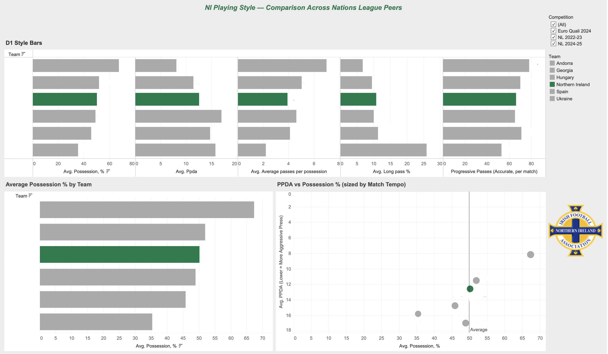
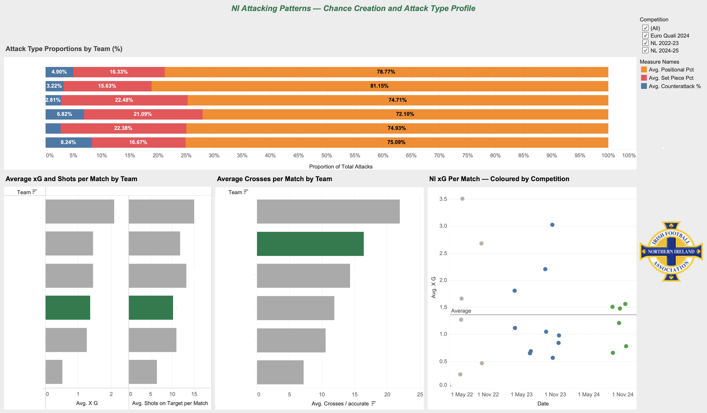
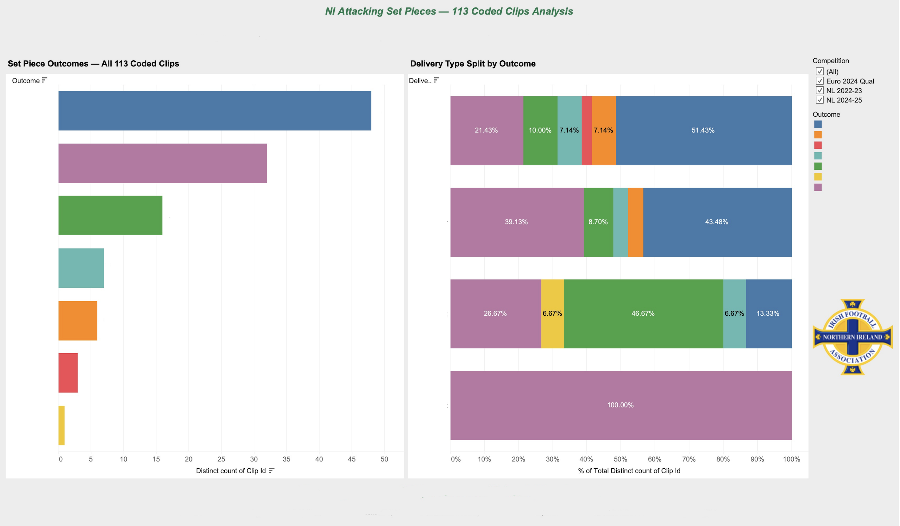
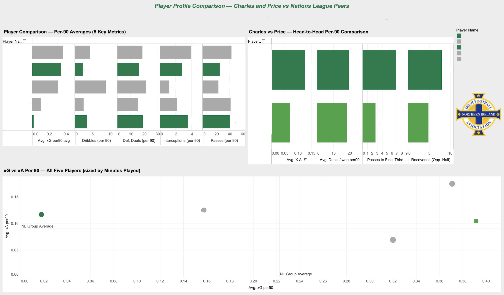
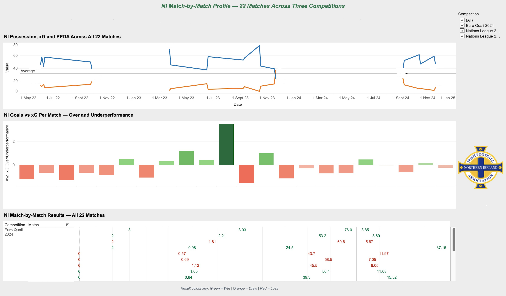

# Tactical Preparation Dashboard Suite: Irish Football Association

**MSc Data Analytics in Sport, TU Dublin: Client project with the Irish Football Association**

[Download the full case study (PDF)](https://github.com/robparkess/thesis-ifa-tactical-dashboard-suite/raw/main/IFA_Portfolio_Case_Study_With_Dashboards.pdf)

## The brief

For my thesis, I reached out to the Irish Football Association and asked if I could work with them to build a tool that would help their coaching staff prepare for an upcoming competitive campaign. Smaller national associations often don't have the same analytical resources as bigger clubs, so the aim was to build something genuinely useful: something that didn't cost anything to keep using and didn't need a data background to understand.

## What I built

A suite of five interconnected Tableau dashboards, each built to answer one specific tactical question a coach or analyst would actually ask:

- **Playing Style Profile**: how does the national team's style compare to the calibre of opponent they're about to face?
- **Attacking Patterns and Chance Creation**: how does the team create chances, and how has that shifted over time?
- **Set Piece Analysis**: built from a manually coded video dataset of attacking set pieces, looking at delivery type and outcome
- **Player Profile Comparison**: per-90 normalised comparisons between the association's own players and comparable international peers, using bar charts and an xG vs xA scatter plot
- **Match-by-Match Form**: results and underlying performance metrics tracked match by match, not just averaged

All five draw on the same cleaned data tables, so the numbers are consistent whichever dashboard a coach opens. Four of the five dashboards include a competition filter, so staff can see whether a pattern holds across all competitions or only some.

## Process

**Data pipeline.** The pipeline was built entirely in Python (pandas, JupyterLab), covering match event exports across multiple competition windows and several teams, plus a manually coded video dataset of attacking set pieces. Every transformation from raw export to dashboard-ready table lives in a separate, rerunnable notebook, so the pipeline could be handed off and reused by the client on future data without being rebuilt from scratch. The dashboards themselves were built in Tableau.

**Design decisions.** A few examples of judgement calls made along the way:
- A commonly misread pressing metric (PPDA) was explicitly labelled on-chart, since a lower value counterintuitively means a more aggressive press, and the intended audience were coaches, not analysts.
- The national team is highlighted in green and every comparison team is kept in neutral grey, so the eye goes straight to where the focal team sits without needing to read a legend.
- One player's dataset had genuine gaps in the exported match data for some metrics. Rather than estimate or quietly exclude the player, the gap was flagged at the pipeline stage and the affected metrics were simply left off that player's profile.
- In the set piece dashboard, delivery types are shown as a percentage split of outcomes rather than raw counts, because the delivery types occur at very different volumes and raw counts would have made the rarer ones impossible to compare fairly.
- Colour-coded results (win, draw, loss) and over/underperformance bars were used in the match-by-match view so a coach can read the story of a campaign at a glance, with a colour key included for clarity.

**Validation.** Findings and dashboard figures were checked against the client's own domain knowledge through several feedback rounds with the IFA's analyst and Head of Technology, and adjusted where their read of the data differed from the raw pipeline output.

## Skills demonstrated

- End-to-end pipeline design: raw sports event data, cleaned and joinable tables, interactive dashboard
- Choosing and justifying metrics for a non-technical audience rather than a technical one
- Structured video coding and integration of qualitative tactical data alongside quantitative event data
- Stakeholder management across an academic supervisor, a client organisation, and informal practitioner reviewers
- Working within a live data licence: using and presenting data appropriately without exceeding the terms it was provided under

## What's not shown here

The dashboards were prepared for the association's coaching staff ahead of a competitive campaign. With the client's approval, the versions shown here have had the labels linking figures to specific comparison teams, players and matches removed, so the charts show the design, structure and layout of the tool but the figures can't be attributed to any of them. Underlying data, notebook outputs and raw exports are not included in this repository.
